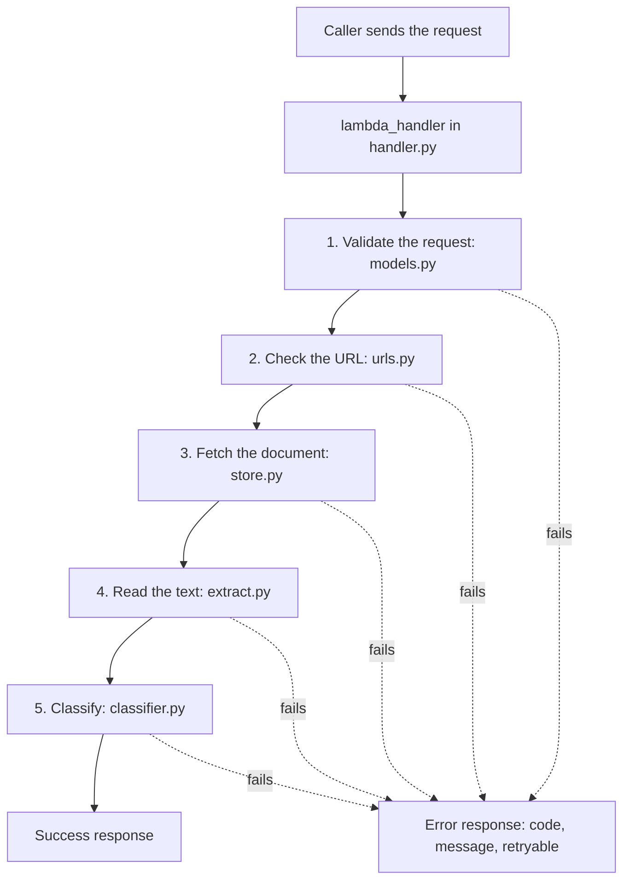

# DocClassify

An AWS Lambda function in Python that receives a document URL plus metadata, retrieves the document, and classifies it as `quote`, `drawing`, `specification`, `bill_of_quantities`, `contract`, or `other`.

## TL;DR

Another service sends a request with a document URL and metadata. The function checks the request and the URL, fetches the document from a document store, reads its text, and classifies it with English and Dutch keywords. It always answers with one JSON object: a category with a confidence, or an error with a stable code and a flag that says whether a retry can help. The document store in the case is fictional, so the function uses a mock store that reads files from a local folder.

### Run it

You need Git and uv. uv installs the right Python version (3.13) by itself.

1. Install Git from [git-scm.com](https://git-scm.com/downloads).
2. Install uv. On Windows, in PowerShell:

   ```powershell
   powershell -ExecutionPolicy ByPass -c "irm https://astral.sh/uv/install.ps1 | iex"
   ```

   On macOS or Linux:

   ```bash
   curl -LsSf https://astral.sh/uv/install.sh | sh
   ```

   Close and reopen the terminal, then check with `uv --version`.
3. Download the repository and install the packages:

   ```bash
   git clone https://github.com/AKTanim/docclassify.git
   cd docclassify
   uv sync
   ```
4. Classify the case's example document:

   ```bash
   uv run python scripts/invoke.py events/quote.json
   ```

   It prints `"category": "quote"`. The sample documents are already in `sample_docs/`. To create them again, run `uv run python scripts/make_samples.py`.
5. Try every sample request. In PowerShell:

   ```powershell
   ls events\*.json | ForEach-Object { uv run python scripts/invoke.py $_.FullName }
   ```

   On macOS or Linux:

   ```bash
   for f in events/*.json; do uv run python scripts/invoke.py "$f"; done
   ```
6. Run the tests and the code checks:

   ```bash
   uv run pytest --cov=docclassify --cov-report=term-missing
   uv run ruff check .
   uv run ruff format --check .
   ```

   Expect 51 passed and 99% coverage.
7. Optional, with Docker installed: run the function inside AWS's Lambda image.

   ```bash
   docker build -t docclassify .
   docker run --rm -p 9000:8080 docclassify
   curl -s -X POST "http://localhost:9000/2015-03-31/functions/function/invocations" -d "@events/quote.json"
   ```

   On Windows, write `curl.exe` instead of `curl`.

### Features

| Feature | Where |
| --- | --- |
| Request validation with one clear error message listing every problem | `models.py` |
| URL checks before fetching: https only, allowed hosts only, no credentials in the URL, not expired | `urls.py` |
| Mock document store with safe file names and a size limit | `store.py` |
| Text from PDFs and text files. The type is decided by the file's first bytes, not the declared type. | `extract.py` |
| PDFs encrypted with an empty password are read. PDFs that need a real password get a clear error. | `extract.py` |
| Files that cannot be read are still classified from the file name, with a warning | `handler.py` |
| Keyword classifier for English and Dutch, using the file name and the text | `classifier.py` |
| Stable error codes with a `retryable` flag. The function never crashes, and bugs never leak details. | `errors.py`, `handler.py` |
| Store and classifier are passed into the handler, so either can be replaced without touching it | `handler.py` |
| 51 tests, 99% line coverage | `tests/` |
| ruff checks and formatting before every commit | `.pre-commit-config.yaml` |
| CI on every push and pull request | `.github/workflows/ci.yml` |
| Container image built on AWS's official Lambda base image | `Dockerfile` |

## Walkthrough

This section follows the case's example request through the code, layer by layer, in the order the code runs. Each layer says which file does the work, what can go wrong there, and how the tests cover it.



### The request

This is the case's example request:

```json
{
  "request_id": "b7e4d2a0-1c3f-4e9b-8f62-5a0d9c7e1b34",
  "document_url": "https://docstore.example.com/f/9f1c2e7a.pdf?exp=1761663129&sig=7d1e9c42",
  "metadata": {
    "document_id": "9f1c2e7a",
    "tenant_id": "contractor-1042",
    "file_name": "Offerte_kozijnen_fase2.pdf",
    "mime_type": "application/pdf"
  }
}
```

It is saved unchanged as `events/expired.json`, for a reason explained in layer 2. `events/quote.json` is the same request with a future expiry time.

### Layer 0: the entry point (`handler.py`)

AWS Lambda calls `lambda_handler(event, context)`. `event` is the request above, turned into a Python dictionary. `context` holds facts about the run, such as the time left. This function does not need it yet.

`lambda_handler` only passes the event to `handle(event, DEPS)`. `DEPS` holds the two outside parts, the document store and the classifier. It is created once, when Lambda loads the file (a cold start), and reused by every request after that.

`handle` first reads `request_id` from the raw event. Then it runs the five layers inside one `try` block:

- Every expected failure raises a subclass of `AppError` (`errors.py`). One `except AppError` turns any of them into the error response.
- Anything else is a bug. `except Exception` logs the full stack trace for the developers and returns `INTERNAL_ERROR` with a safe message. Callers never see stack traces, because those reveal how the code works.
- So `handle` always returns a dictionary and never raises. A caller never has to deal with a crash.

### Layer 1: validate the request (`models.py`)

pydantic checks the event against two models, `ClassifyRequest` and `Metadata`.

| Rule | Why |
| --- | --- |
| All fields are required and must be text | `tenant_id: 1042` is rejected, not silently turned into `"1042"` |
| Spaces around values are stripped, then every value must have at least 1 character | `"   "` counts as missing |
| Maximum lengths, such as 255 characters for `file_name` | A caller cannot send huge values |
| Unknown fields are ignored | Callers can add fields later without breaking this service |

The case request passes. A request without a URL returns:

```json
{
  "request_id": "c1d2e3f4-0000-4000-8000-000000000005",
  "status": "error",
  "error": {
    "code": "INVALID_REQUEST",
    "message": "Invalid request. document_url: Field required; metadata.document_id: Field required; metadata.file_name: Field required; metadata.mime_type: Field required",
    "retryable": false
  }
}
```

The message lists every problem at once, so the caller can fix them in one go. If the event is not a dictionary at all, `request_id` is `null` and the message names the whole request.

**Tests:** `tests/test_models.py`, 8 tests. A valid request, stripping, ignoring unknown fields, a missing URL, and four kinds of bad metadata (a number instead of text, two blank values, an over-long file name). Every test builds a fresh event with `valid_event()`, so no test can change another test's data.

### Layer 2: check the URL (`urls.py`)

The caller chooses the URL, so the service must not fetch from just anywhere. A service that fetches any URL can be used to reach internal systems, such as `http://localhost/admin`. This is called server-side request forgery (SSRF). `check_url` runs before anything is fetched:

| Check | Case URL | Error if Fails |
| --- | --- | --- |
| Scheme is `https` | `https` | `URL_NOT_ALLOWED` |
| No user name or password in the URL | none | `URL_NOT_ALLOWED` |
| Host is on the allow list (`ALLOWED_HOSTS`) | `docstore.example.com` | `URL_NOT_ALLOWED` |
| `exp` is a whole number | `1761663129` | `INVALID_REQUEST` |
| `exp` is not in the past | 28 October 2025, already past | `URL_EXPIRED` |

The case URL is a signed URL: `exp` is the Unix time when it stops working and `sig` proves the store created it. **The case's own example has already expired**, so it stops here:

```json
{
  "request_id": "b7e4d2a0-1c3f-4e9b-8f62-5a0d9c7e1b34",
  "status": "error",
  "error": {
    "code": "URL_EXPIRED",
    "message": "The URL has expired. Ask the document store for a new one.",
    "retryable": false
  }
}
```

`retryable` is `false`, because sending the same URL again cannot work. The caller needs a new URL from the store.

To follow the rest of the flow, `events/quote.json` uses `exp=4102444800`, which is 1 January 2100.

The signature is not checked here, because that needs the store's secret key. The real store checks it when the file is downloaded. URLs without `exp` are accepted, because the case does not say every URL is signed.

**Tests:** `tests/test_urls.py`, 9 tests. Valid URLs with and without `exp`, five unsafe URLs (`http`, another host, credentials, `localhost`, `file:///etc/passwd`), an expired URL, and an `exp` that is not a number. `tests/test_handler.py` also checks that an expired URL is refused before the store is asked.

### Layer 3: fetch the document (`store.py`)

The store is described by a Protocol, `DocumentStore`: anything with a method `fetch(url) -> bytes` counts as a store. The handler only ever calls `fetch`. It does not know which store it has.

The mock, `LocalDocumentStore`, reads files from a folder (`DOCUMENT_STORE_DIR`, default `sample_docs`). It takes the last part of the URL's path as the file name, so the case URL reads `sample_docs/9f1c2e7a.pdf`.

| Step | Case request | Fails with |
| --- | --- | --- |
| Take the last path part | `/f/9f1c2e7a.pdf` becomes `9f1c2e7a.pdf` |  |
| Check it is a safe name: a letter or digit first, then only letters, digits, `.`, `_` and `-` | passes | `DOCUMENT_NOT_FOUND` |
| Check the file exists | yes | `DOCUMENT_NOT_FOUND` |
| Check the size before reading (`MAX_DOCUMENT_BYTES`, default 10 MB) | 1,046 bytes | `DOCUMENT_TOO_LARGE` |
| Read the bytes | 1,046 bytes | `STORE_UNAVAILABLE` (retryable) |

Taking only the last path part stops `../` tricks: `/f/../secret.txt` becomes `secret.txt`, which is looked for inside the store's folder only. The safe-name check stops a Windows-only trick: `..\secret.txt` is one name to a URL, but a path to Windows. `STORE_UNAVAILABLE` is the only retryable code so far, because a read problem may be temporary.

**Tests:** `tests/test_store.py`, 6 tests. Each uses pytest's `tmp_path`, a fresh empty folder per test: the URL picks the file, a missing file, a URL with no file name, the `../` and `..\` tricks, and a file one byte over the limit.

### Layer 4: read the text (`extract.py`)

The store returns bytes. The classifier needs text. A PDF cannot simply be decoded: its words are usually stored compressed.

| Step | Case request |
| --- | --- |
| Look at the first bytes, not the declared `mime_type` | Starts with `%PDF-`, so it is read as a PDF |
| Open it with pypdf. If it is encrypted, try the empty password. | Not encrypted |
| Read the pages until 20,000 characters | `Offerte kozijnen fase 2`, `Totaal: EUR 48.250 excl. btw`, `Geldig tot 31 maart 2026` |

What can go wrong:

| Situation | Result |
| --- | --- |
| A damaged PDF, a PDF that needs a real password, or a text file that is not valid UTF-8 | `UNREADABLE_DOCUMENT` |
| A type that cannot be read here, such as an image or a `.dwg` drawing | Not an error. The handler sets the text to empty and adds the warning `content_not_read`. |
| A readable file with no text, such as a scanned PDF | The warning `no_text_found` |

In both warning cases the classifier still works on the file name. A drawing called `plattegrond_A01.dwg` is still classified as `drawing`. That is more useful to the caller than an error.

**Tests:** `tests/test_extract.py`, 9 tests. The tests build small PDFs in memory with fpdf2, including encrypted ones, instead of storing sample files: PDF text, a PDF sent with the wrong type, UTF-8 text with `ï`, the 20,000-character limit, invalid UTF-8, a PNG, a damaged PDF, and both kinds of encrypted PDF.

### Layer 5: classify (`classifier.py`)

The classifier is also described by a Protocol, `Classifier`, with one method `classify(text, file_name)`.

`KeywordClassifier` splits the file name and the text into lower-case words, then counts English and Dutch keywords per category. The category with the most hits wins. Confidence is the winner's share of all hits.

For the case request, the words include `offerte` twice (from the file name and the text) and the phrase `geldig tot` once. That is 3 quote hits and no others, so the result is `quote` with confidence `1.0`.

| Design choice | Why |
| --- | --- |
| Whole words only | "contractor" must not count as "contract" |
| The file name counts | `Offerte_...` is strong evidence, and it is all we have for unreadable files |
| No hits gives `other` with 0.0 | An honest "no evidence", which callers can filter on |
| Confidence is a share of hits | Simple and explainable. It is not a calibrated probability. |

**Tests:** `tests/test_classifier.py`, 11 tests. Word splitting, phrase counting, one example per category, the file name alone, no keywords, the confidence share (2 of 3 hits gives 0.67), and "contractor".

### Layer 6: the response (`handler.py`)

```json
{
  "request_id": "b7e4d2a0-1c3f-4e9b-8f62-5a0d9c7e1b34",
  "status": "ok",
  "document_id": "9f1c2e7a",
  "category": "quote",
  "confidence": 1.0,
  "classifier": "keywords",
  "warnings": []
}
```

The case's suggested response, `{"category": "quote", "confidence": 0.87}`, was a starting point. I added `request_id` and `document_id` so callers can match answers to requests, `status` so success and error are easy to tell apart, `classifier` so a later LLM answer can be told apart from a keyword answer, and `warnings` for partial results.

**Tests:** `tests/test_handler.py`, 8 tests. They call `handle` with fake parts: a `FakeStore` that keeps documents in a dictionary, and a `BrokenClassifier` that raises an unexpected error. One test compares the whole success response, so renaming a field breaks a test before it breaks a caller.

### From local mock to real AWS

The code that runs in AWS is the same code that runs on a laptop. Only the parts around it change:

| Part | On a laptop | In AWS |
| --- | --- | --- |
| Caller | `scripts/invoke.py` reads a file from `events/` | Another service calls the function, for example with `boto3`'s `invoke` |
| `event` | The JSON file, turned into a dictionary | The caller's JSON payload, turned into a dictionary by AWS |
| `context` | `None` | AWS's context object: request ID, time left, memory limit |
| Document store | `LocalDocumentStore` reads `sample_docs/` | A real store class that downloads the signed URL |
| Settings | Defaults in `build_deps()` | Environment variables set on the function |
| Packages | `.venv`, created by uv | The container image built from `Dockerfile` |
| Logs | The terminal | CloudWatch Logs, in the log group `/aws/lambda/<function name>` |

**Replacing the mock store:** The handler only knows the `DocumentStore` Protocol. A real store is a new class with the same `fetch(url) -> bytes` method. It would download the signed URL over https with a connect and read timeout, refuse redirects, stop reading once the size limit is passed, and translate the store's answers into the existing errors: 404 becomes `DOCUMENT_NOT_FOUND`, 401 or 403 becomes `URL_EXPIRED`, and timeouts or 5xx become the retryable `STORE_UNAVAILABLE`.

The same applies to the classifier: any class with `classify(text, file_name)` can replace `KeywordClassifier`.

### How the tests are planned

Each layer is tested on its own, with fakes at the edges, and the handler tests check that the layers work together. No test needs the internet, real documents, or a particular date.

| Layer | Test file | Tests | Fakes and tools | Main question it answers |
| --- | --- | --- | --- | --- |
| Request | `test_models.py` | 8 | `valid_event()` builds a fresh event per test | Is every bad request rejected with a clear reason? |
| URL | `test_urls.py` | 9 | A fixed time instead of the clock | Is every unsafe or expired URL refused? |
| Store | `test_store.py` | 6 | `tmp_path`, a fresh folder per test | Does it read only safe files inside its folder, within the size limit? |
| Text | `test_extract.py` | 9 | PDFs built in memory with fpdf2 | Is every readable type read, and every unreadable one reported? |
| Classifier | `test_classifier.py` | 11 | `@pytest.mark.parametrize` for one case per category | Does each category win on its keywords, with an honest confidence? |
| Handler | `test_handler.py` | 8 | `FakeStore`, `BrokenClassifier`, a fixed clock | Does every path end in the right response, and does the success format stay the same? |

CI runs ruff and all tests on every pull request, and each feature was merged through its own pull request.

## Next steps

### 1. Structured JSON logging

- **Why:** when another team asks why a request failed, the logs must answer quickly. Today failures are logged as plain text, which is hard to search.
- **How it fits:** one JSON line per event (`request_received`, `request_done`, `request_failed`) with `request_id`, `tenant_id`, `document_id`, the result or error code, and the time taken. The URL is logged without its signature, and the document text is never logged.
- **In AWS:** Lambda sends these logs to CloudWatch automatically. CloudWatch Logs Insights can search the JSON fields, for example to count failures per error code, and an alarm can fire when `INTERNAL_ERROR` appears.

### 2. LLM classifier, keeping the keyword classifier

- **Why:** better accuracy on real documents, once accuracy matters.
- **How it fits:** a new class with the same `classify(text, file_name)` method, so the handler does not change. A fallback wraps it: if the LLM fails or is too slow, the keyword classifier answers. The response's `classifier` field shows which one answered.
- **Why keep the keyword classifier:** it is the backup, a free first pass when the keywords are clear, and the baseline the LLM must beat.
- **API:** a short timeout, the reply checked with pydantic (an unexpected answer becomes `other`), and the document text marked as data, not instructions, to resist prompt injection.
- **Cost and caps:** send only the start of the text, store answers per document so the same file never costs twice, and set a spending limit plus a limit per tenant.
- **Secrets:** the API key lives in AWS Secrets Manager, never in code, committed files or logs.

### 3. AWS setup

- **Why:** the case asks for code that is ready to deploy. The Dockerfile builds the image, and these steps put it live.
- **Steps:**
  - Push the image to Amazon ECR, AWS's container registry.
  - Create the Lambda function from the image, with a role that allows writing logs.
  - Set the timeout and memory. The defaults, 3 seconds and 128 MB, are too small for large PDFs. Start with about 30 seconds and 512 MB, then adjust.
  - Set `ALLOWED_HOSTS` and `MAX_DOCUMENT_BYTES`.
  - Give the calling services permission to invoke the function.
  - Replace the mock store with a real one that downloads the signed URL. This is a one-line change in `build_deps()`.

## AI log

I used Claude (Anthropic) for help. Here's a short log of where I used it:

- **Debugging:** explained terminal errors and helped fix bugs during development.
- **Test planning:** helped plan the test scenarios layer by layer, including the error cases.
- **Test data:** created the sample documents, the sample events, and the PDFs the tests build in memory.
- **Keyword classifier:** drafted the English and Dutch keyword lists and the whole-word matching.
- **Dockerfile setup:** drafted the Dockerfile on AWS's Lambda base image and the `requirements.txt` export.
- **README polish:** helped draft and polish this README.

## Reference

### Contract

The function is invoked directly, not through an HTTP API. So it returns a JSON object, not an HTTP status code.

**Request fields.** All are required text. Spaces around values are stripped, and unknown fields are ignored.

| Field | Maximum length |
| --- | --- |
| `request_id` | 100 |
| `document_url` | 2,000 |
| `metadata.document_id` | 200 |
| `metadata.tenant_id` | 200 |
| `metadata.file_name` | 255 |
| `metadata.mime_type` | 100 |

**Success fields.** `request_id`, `status` (`"ok"`), `document_id`, `category`, `confidence` (0.0 to 1.0), `classifier` (`"keywords"`), and `warnings` (a list).

**Error fields.** `request_id` (`null` if the request had none), `status` (`"error"`), and `error` with `code`, `message` and `retryable`.

| Code | Meaning | Retry helps |
| --- | --- | --- |
| `INVALID_REQUEST` | Missing or wrong fields, or an `exp` that is not a number | No |
| `URL_NOT_ALLOWED` | Not https, a host not on the allow list, or credentials in the URL | No |
| `URL_EXPIRED` | The signed URL's `exp` has passed. Ask the store for a new URL. | No |
| `DOCUMENT_NOT_FOUND` | The store has no document at the URL | No |
| `DOCUMENT_TOO_LARGE` | The document is over `MAX_DOCUMENT_BYTES` | No |
| `STORE_UNAVAILABLE` | The store could not be read | Yes |
| `UNREADABLE_DOCUMENT` | A damaged file, a PDF that needs a password, or text that is not UTF-8 | No |
| `INTERNAL_ERROR` | A bug on our side | No |

| Warning | Meaning |
| --- | --- |
| `content_not_read` | The file type cannot be read, so it was classified from the file name only |
| `no_text_found` | The file had no text, for example a scanned PDF, so it was classified from the file name only |

### Settings

| Variable | Default | Meaning |
| --- | --- | --- |
| `ALLOWED_HOSTS` | `docstore.example.com` | Hosts documents may be fetched from, separated by commas |
| `DOCUMENT_STORE_DIR` | `sample_docs` | Folder the mock store reads from. `/var/task/sample_docs` in the container image. |
| `MAX_DOCUMENT_BYTES` | `10000000` | Largest document the service reads, in bytes (10 MB) |

`.env.example` lists them with safe values.

### Project layout

```text
docclassify/
  .github/workflows/ci.yml   ruff and tests on every push and pull request
  events/                    sample requests, including the case's own (expired.json)
  sample_docs/               files the mock store serves
  scripts/
    make_samples.py          creates the sample documents
    invoke.py                calls the handler the way AWS would
  src/docclassify/
    errors.py                every error, with its code and retryable flag
    models.py                request models and the categories
    urls.py                  URL checks before fetching
    store.py                 the store Protocol and the mock store
    extract.py               text from PDFs and text files
    classifier.py            the classifier Protocol and the keyword classifier
    handler.py               the Lambda entry point
  tests/                     one test file per source file, plus shared helpers
  Dockerfile                 the Lambda container image
  requirements.txt           runtime packages for the image, exported from uv.lock
  pyproject.toml, uv.lock    project settings and exact package versions
```

### Assumptions

- The document store is fictional. The mock store serves files from a folder, and the last part of the URL's path is the file name.
- The caller is trusted, because AWS controls who may invoke the function.
- URLs without `exp` are accepted. The signature (`sig`) is checked by the real store, which holds the key.
- Confidence from the keyword classifier is a share of keyword hits, not a calibrated probability.

### Known limits

- Only PDFs with a text layer and text files are read. Other files are classified from the file name.
- The keyword lists are short, and Dutch compound words only match when listed in full.
- Logs are plain text until JSON logging is added (next step 1).
